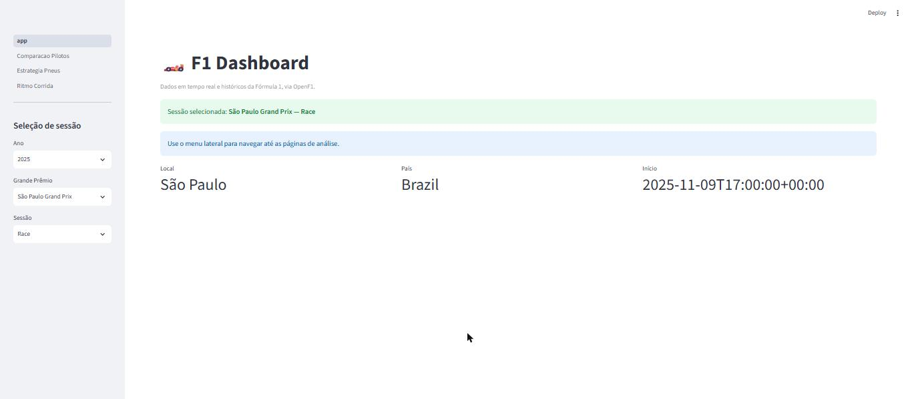
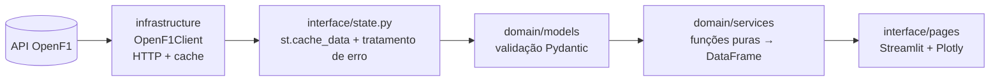

# 🏎️ F1 Dashboard: análise de dados de Fórmula 1 com a API OpenF1


Dashboard interativo que busca dados públicos de Fórmula 1 na [API OpenF1](https://openf1.org), valida e transforma esses dados com Pydantic e pandas, e apresenta as análises em Streamlit com gráficos Plotly.



## Objetivo

Praticar um fluxo completo de dados: **consumir uma API → validar → transformar → visualizar**, usando uma organização de código que dá para testar e manter:

- separação clara entre acesso a dados, regra de negócio e interface;
- regras de negócio como funções puras, testadas sem rede;
- tratamento de erros da API sem quebrar a tela do usuário;
- documentação técnica publicada com MkDocs.

## O que o dashboard mostra

Escolha o **ano**, o **Grande Prêmio** e a **sessão** (treino, classificação, sprint ou corrida) na barra lateral. Depois navegue pelas três análises:

| Página | O que responde | Endpoints usados |
| --- | --- | --- |
| **Comparação de Pilotos** | Quem foi mais rápido volta a volta? Qual foi a melhor volta de cada um? Como a velocidade se compara na telemetria? | `drivers`, `laps`, `car_data` |
| **Estratégia de Pneus** | Que compostos cada piloto usou, por quantas voltas, e quando parou nos boxes? | `drivers`, `stints`, `pit` |
| **Ritmo de Corrida** | Como evoluiu o gap para o líder? Quando houve bandeira ou Safety Car? Como estavam pista e clima? | `drivers`, `intervals`, `race_control`, `weather` |

Os dados da OpenF1 cobrem as temporadas a partir de 2023.

## Arquitetura



```text
src/f1/
├── infrastructure/   # cliente HTTP da OpenF1 (sem regra de negócio)
├── domain/
│   ├── models.py     # entidades Pydantic (Lap, Stint, PitStop, Interval...)
│   └── services/     # comparação de pilotos, estratégia de pneus, ritmo de corrida
└── interface/        # app Streamlit: home + 3 páginas de análise
```

Decisões principais:

- **Três camadas.** A interface nunca chama a API direto, e as regras de negócio não fazem I/O. Por isso os services são testados com dados mockados.
- **Pydantic com `extra="ignore"`.** Se a API ganhar campos novos, nada quebra. E dado malformado é barrado antes de chegar aos cálculos.
- **Dois níveis de cache.** Um em memória no cliente e outro com `st.cache_data` (5 min) na interface, para não repetir chamadas à API.
- **Falha sem quebrar a tela.** Erros de rede ou HTTP viram um aviso na página em vez de uma exceção.

Mais detalhes em [docs/arquitetura.md](docs/arquitetura.md).

## Como rodar

Pré-requisitos: Python 3.12+ e [Poetry](https://python-poetry.org/) 2.x.

```bash
git clone https://github.com/riulersilverio/projeto_f1.git
cd projeto_f1
poetry install
poetry run task app        # abre em http://localhost:8501
```

A API OpenF1 é pública: não precisa de chave nem de arquivo `.env`.

## Testes e qualidade

```bash
poetry run task test   # pytest + cobertura
poetry run task lint   # ruff (lint + formatação)
poetry run task docs   # documentação em http://localhost:8000
```

São **36 testes**, com chamadas HTTP simuladas por `requests-mock`. A cobertura é de **99% no domínio e na infraestrutura**. A interface Streamlit ainda não tem testes automatizados, então a cobertura total fica em 71%.

## Documentação

A pasta [docs/](docs/) vira um site com MkDocs Material:

- [Arquitetura](docs/arquitetura.md)
- [API OpenF1: endpoints usados](docs/api_openf1.md)
- [Modelos de domínio](docs/modelos.md)
- Páginas: [Comparação de Pilotos](docs/paginas/comparacao_pilotos.md) · [Estratégia de Pneus](docs/paginas/estrategia_pneus.md) · [Ritmo de Corrida](docs/paginas/ritmo_corrida.md)

## Próximos passos

- [ ] Telemetria por volta escolhida, em vez da sessão inteira: numa corrida são dezenas de milhares de pontos por piloto, e o gráfico fica pesado.
- [ ] Testes da interface com `streamlit.testing.AppTest`.
- [ ] Mapa da pista com o endpoint `location` (o cliente já tem `get_location`).
- [ ] Publicar no Streamlit Community Cloud.
- [ ] GitHub Actions rodando lint e testes a cada push.

## Fonte dos dados

[OpenF1](https://openf1.org) é uma API aberta e não oficial, sem vínculo com a Formula 1. Os nomes e marcas de F1 pertencem aos seus donos.

## Autor

**Riuler Silvério**: [GitHub](https://github.com/riulersilverio)
